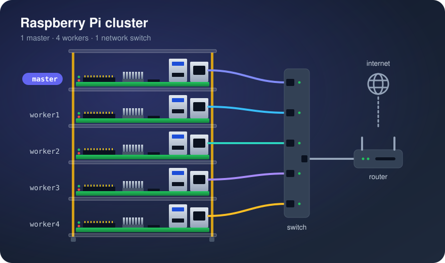

[Cluster Guide](docs/Cluster_Guide.md) · [Getting Started](docs/Getting_Started.md) · [Troubleshooting](docs/Troubleshooting.md)

# Raspberry Pi Cluster

A step-by-step guide to building a portable cluster of five Raspberry Pi 5 or Raspberry Pi 4 boards that stores data with Hadoop (HDFS) and trains machine learning models in parallel with Spark.

## Builds

The cluster was first built in 2020 on Raspberry Pi 4 boards and ran Hadoop and Spark successfully. The guide has since been updated for current software and for the **Raspberry Pi 5**, the newest model, while keeping full support for the **Raspberry Pi 4**. Where the two boards need different parts or settings, the guide shows both.

| Build | When | Boards | Operating system | Result |
| --- | --- | --- | --- | --- |
| Original build | 2020 | 5 × Raspberry Pi 4 Model B, 2 GB | Raspbian (2020 release) | **Worked**, including HDFS and Spark. The Hadoop and Spark pages were written later, in the 2026 update |
| 2026 update | October 2026 | Written for 5 × Raspberry Pi 5 or 5 × Raspberry Pi 4 | Raspberry Pi OS Lite 64-bit (Debian 13) | Not built on hardware. Steps updated from the original build; the training job was tested on a Spark 4.2 cluster on a regular computer |

Built it with these steps? Please [open an issue](https://github.com/gitluis/pi-cluster/issues) with your boards, RAM, OS image date and [benchmark](docs/Workload.md#benchmark) time, or if a step didn't work for you.

## The guide

| Step | Page | At the end you have |
| :-: | --- | --- |
| 1 | [Hardware List](docs/Hardware_List.md) | Everything bought and assembled, with enough power and cooling |
| 2 | [Install OS](docs/Install_OS.md) | Five cards flashed, each node reachable over SSH |
| 3 | [The Pi Network](docs/The_Pi_Network.md) | Fixed addresses, nodes reachable by name, SSH keys |
| 4 | [Cluster Commands](docs/Cluster_Commands.md) | One command to run anything on every node |
| 5 | [Cluster Security](docs/Cluster_Security.md) | Key-only logins, fail2ban and a firewall |
| 6 | [Single Node Setup](docs/Single_Node_Setup.md) | Java everywhere; HDFS on `master` alone |
| 7 | [Cluster Setup](docs/Cluster_Setup.md) | HDFS across four workers |
| 8 | [Spark](docs/Spark.md) | Spark with one executor per worker |
| 9 | [Workload](docs/Workload.md) | 300 models trained, one per worker at a time, and a benchmark |

New here? Read [Getting Started](docs/Getting_Started.md) first. [Background](docs/Background.md) explains Hadoop and Spark; [Purpose](docs/Purpose.md) explains why this cluster exists.

## What you need

- Five Raspberry Pi 5 boards (4 GB minimum, 8 GB recommended) or five Raspberry Pi 4 boards (2 GB minimum, 4 GB recommended), each with its official power supply and cooling, plus microSD cards, an 8-port switch and cables. See [Hardware List](docs/Hardware_List.md).
- A Windows, macOS or Linux computer with a card reader.
- Comfort typing commands in a terminal. No Hadoop or Spark experience needed.

The guide uses Raspberry Pi OS Lite (64-bit), Java 17, Hadoop 3.5.0 and Spark 4.2.1. [Versions](docs/Versions.md) explains why these.

## What's in this repository

| Folder | Contents |
| --- | --- |
| [`docs/`](docs/) | The guide's pages, with original images in [`docs/img/`](docs/img/) |
| [`scripts/`](scripts/) | `cluster_commands.sh` (run commands on every node), `setup_hosts.sh` (hostname map), `generate_images.py` (rebuilds the icons and step diagrams) |
| [`workload/`](workload/) | The training job, a sample data generator, and the Python package list |

## What is a Raspberry Pi?

A Raspberry Pi is a credit-card-sized, low-cost computer board. It can do most of what a desktop computer does: browse the internet, play video, edit documents and spreadsheets, or run a server.

The Raspberry Pi 5, the newest model, comes with 1 to 16 GB of memory (RAM), and the Raspberry Pi 4 Model B with 1 to 8 GB, so for many tasks it's hard to tell apart from a regular computer.

The main difference is the [**central processing unit (CPU)**](https://www.tutorialspoint.com/computer_fundamentals/computer_cpu.htm). Desktop and laptop processors mostly use the [x86 architecture](https://www.techopedia.com/definition/5334/x86-architecture), made by [Intel](https://www.intel.com/) and [AMD](https://www.amd.com/). The Raspberry Pi uses an [ARM processor](https://www.techopedia.com/definition/14875/arm-processor), the same family found in most phones.

Each architecture has its own instruction set, so software must be built for the one it runs on: a program built for x86 won't run on ARM. That's why the guide downloads ARM (`aarch64`) builds of Hadoop and uses Raspberry Pi OS, which is built for the Pi.

For other things to do with a Raspberry Pi, see the Raspberry Pi Foundation's [projects site](https://projects.raspberrypi.org/en).

# Acknowledgements

Many thanks to the tutorials this guide builds on. I don't claim the whole guide as my own: it's what worked for me after following others and adding to them.

See [References](docs/References.md) for the sources and resources I used.
