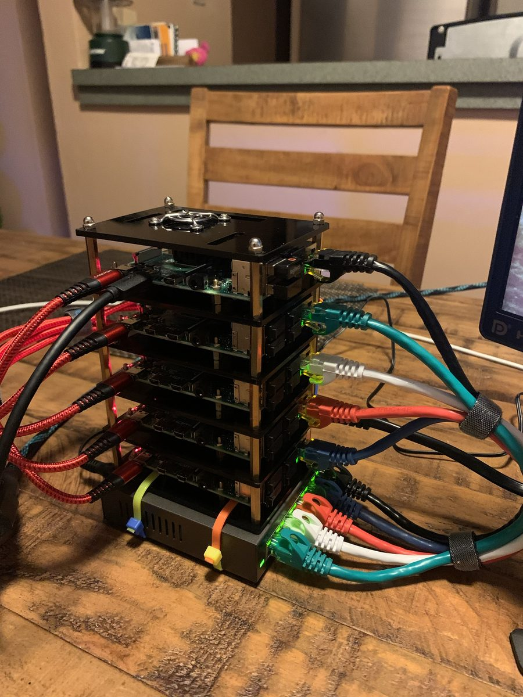

[Getting Started](docs/Getting_Started.md) · [Cluster Guide](docs/Cluster_Guide.md) · [Troubleshooting](docs/Troubleshooting.md) · [About](docs/About.md)

# Raspberry Pi Cluster

A step-by-step guide to building a portable cluster of five Raspberry Pi 5 or Raspberry Pi 4 boards that stores data with Hadoop (HDFS) and trains machine learning models in parallel with Spark.

## What is a Raspberry Pi?

A Raspberry Pi is a credit-card-sized, low-cost computer board. It can do most of what a desktop computer does: browse the internet, play video, edit documents and spreadsheets, or run a server.

The Raspberry Pi 5, the newest model, comes with 1 to 16 GB of memory (RAM), and the Raspberry Pi 4 Model B with 1 to 8 GB, so for many tasks it's hard to tell apart from a regular computer.

The main difference is the [**central processing unit (CPU)**](https://www.tutorialspoint.com/computer_fundamentals/computer_cpu.htm). Desktop and laptop processors mostly use the [x86 architecture](https://www.techopedia.com/definition/5334/x86-architecture), made by [Intel](https://www.intel.com/) and [AMD](https://www.amd.com/). The Raspberry Pi uses an [ARM processor](https://www.techopedia.com/definition/14875/arm-processor), the same family found in most phones.

Each architecture has its own instruction set, so software must be built for the one it runs on: a program built for x86 won't run on ARM. That's why the guide downloads ARM (`aarch64`) builds of Hadoop and uses Raspberry Pi OS, which is built for the Pi.

For other things to do with a Raspberry Pi, see the Raspberry Pi Foundation's [projects site](https://projects.raspberrypi.org/en).

## Status

First built in 2020 on five Raspberry Pi 4 boards, with Hadoop and Spark working. The 2026 update adds the Raspberry Pi 5 and current software, but hasn't been built on hardware yet. [Builds](docs/About.md#builds) has the details and [photos of the original build](docs/About.md#the-original-build).

Built it with these steps? Please [open an issue](https://github.com/gitluis/pi-cluster/issues) with your boards, RAM, OS image date and [benchmark](docs/Workload.md#benchmark) time, or if a step didn't work for you.

## The guide

The [Cluster Guide](docs/Cluster_Guide.md) takes you from an empty desk to 300 trained models in nine steps.

# Acknowledgements

Many thanks to the tutorials this guide builds on. I don't claim the whole guide as my own: it's what worked for me after following others and adding to them.

See [References](docs/References.md) for the sources and resources I used.
