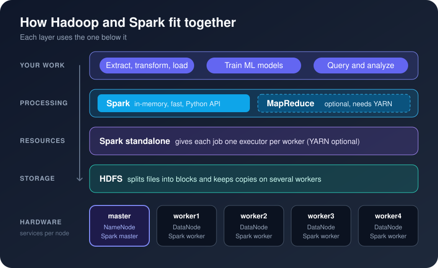

[Background](Background.md) / [Purpose](Purpose.md) / [Getting Started](Getting_Started.md) / [Cluster Guide](Cluster_Guide.md)

# Background

We live in a digital world full of data. Whether that is un-, semi- or structured data, there is a lot of things we can do with it if we make use of Machine Learning (ML). More specifically, supervised, unsupervised or reinforcement learning algorithms are used to build models that learn (train) and discover patterns from historical data to predict an outcome. There are numerous applications of ML such as weather forecast (prediction), storm tracking models, among others.

- [**Hadoop**](https://hadoop.apache.org) is a software framework for storing and processing large data sets across a cluster of computers. This guide uses its file system, **HDFS**, which splits files into blocks and keeps copies of each block on several machines.
- [**MapReduce**](https://www.tutorialspoint.com/hadoop/hadoop_mapreduce.htm) is Hadoop's original way of processing data in parallel: a *map* step works on each block where it's stored, and a *reduce* step combines the results. [MapReduce explained](https://www.youtube.com/watch?v=lgWy7BwIKKQ).
- [**Spark**](https://spark.apache.org/) is a newer engine for large-scale data processing. It keeps data in memory between steps, which makes it much faster than MapReduce, and you can drive it from Python.

It all sounds similar, so here is how the pieces fit together on this cluster:

The cluster lets you extract, transform and load (ETL) data and train models with Spark, while HDFS stores the data. Analysis and visualization of the results are up to you.
