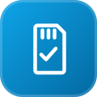
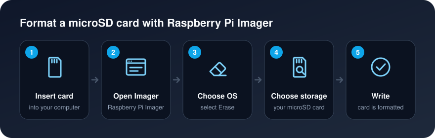

[Background](Background.md) / [Purpose](Purpose.md) / [Getting Started](Getting_Started.md) / [Cluster Guide](Cluster_Guide.md)

# Formatting SD Cards

Formatting an SD card depends on the type of operating system you are using. Whether you use Linux, Windows or Mac OS, the method to format the SD card is different per operating system.

**Note:** SD cards higher than 32GB are considered SDXC cards instead, read  [SDXC Formatting Guide](https://www.raspberrypi.org/documentation/installation/sdxc_formatting.md) for more details.

## Raspberry Pi Imager Downloads

* [Download Raspberry Pi Imager for Windows](https://downloads.raspberrypi.org/imager/imager.exe)
* [Download Raspberry Pi Imager for macOS](https://downloads.raspberrypi.org/imager/imager.dmg)
* [Download Raspberry Pi Imager for Ubuntu](https://downloads.raspberrypi.org/imager/imager_amd64.deb)

## Format SD Card

1. Download [Raspberry Pi Imager](Formatting-SD-Cards#raspberry-pi-imager-downloads)
2. Install Raspberry Pi Imager in your computer
3. Insert your micro SD card to your computer
4. Open Raspberry Pi Imager
5. Click on `Choose OS`

6. Select `Erase`

7. Click on `Choose SD Card`

8. Select your micro SD card

9. Click on `Write`

10. micro SD Card is now formatted successfully
11. Remove micro SD card from your computer
12. Done
