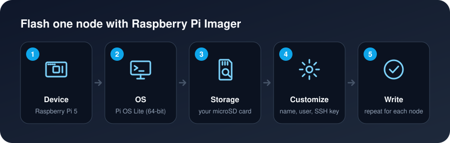
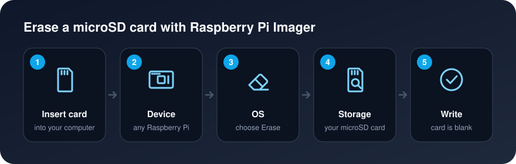

[Home](../README.md) · [Cluster Guide](Cluster_Guide.md) · [Troubleshooting](Troubleshooting.md)


# Install OS

**Goal:** five microSD cards, each with Raspberry Pi OS Lite (64-bit), its own hostname, your user, and SSH access with your key, ready to boot without a keyboard or monitor.

**Run on:** your own computer.

* [Before you start](#before-you-start)
* [Flash each card](#flash-each-card)
* [First boot](#first-boot)
* [Update every node](#update-every-node)
* [Erase a card](#erase-a-card)


# Before you start

1. Install [Raspberry Pi Imager](https://www.raspberrypi.com/software/) on your computer (Windows, macOS or Linux). This guide follows Imager 2.

2. Make an SSH key on your computer if you don't have one. Imager copies the public half to each card, so you can log in to every node without a password.

    ```bash
    ssh-keygen -t ed25519
    ```

    Press Enter to accept the default file (`~/.ssh/id_ed25519`). A passphrase is optional but recommended. This works in the macOS and Linux terminal and in Windows PowerShell.

3. Choose a username for the cluster and use the **same one on every node**. This guide uses `alice`. Avoid `pi`: it was the old default, so it's the first name attackers try.


# Flash each card



Do this five times, once per card. Imager remembers your settings, so after the first card you only change the hostname.

1. Insert a microSD card into your computer and open Raspberry Pi Imager.
2. **Device:** choose *Raspberry Pi 5* or *Raspberry Pi 4*, whichever boards you have.
3. **Operating system:** choose *Raspberry Pi OS (other)*, then *Raspberry Pi OS Lite (64-bit)*.
4. **Storage:** choose your microSD card, or your SSD in a USB adapter if you use one ([Storage](Hardware_List.md#storage)). Double-check you picked the right drive: everything on it will be erased.
5. **Customize:** fill in the settings below.
6. **Write**, confirm, and wait. Imager writes the card and then verifies it.
7. Label the card with its hostname, then repeat with the next card.

| Setting | Value |
| --- | --- |
| Hostname | `master` for the first card, then `worker1` to `worker4` |
| Location | Your time zone and keyboard layout (for example `America/Puerto_Rico`) |
| User | Your cluster username (`alice`) and a strong password. The password is still used for `sudo` |
| Wi-Fi | Leave empty: the nodes use Ethernet |
| Remote access | Turn on SSH and choose **public-key authentication**, then add your public key (`~/.ssh/id_ed25519.pub`) |
| Raspberry Pi Connect | Leave off |

Imager's screens change between versions, but the settings stay the same. Imager saves them on the card's boot partition, and the Pi applies them on its first boot.


# First boot

1. Put each card in its Pi, connect all Pis to the switch, connect the switch to your router, then power them on.
2. Wait about two minutes. The first boot takes longer while the Pi resizes its file system and applies your settings.
3. From your computer, log in to `master`:

    ```bash
    ssh alice@master.local
    ```

    Answer `yes` to the question about the host's fingerprint.

**Check:** you get the `alice@master:~ $` prompt without typing a password. Try `ssh alice@worker1.local` and the other workers the same way.

If `master.local` isn't found, your network may not support these `.local` names. Find the Pi's IP address in your router's list of connected devices and use `ssh alice@<ip-address>` instead. [The Pi Network](The_Pi_Network.md) gives each node a fixed address next.


# Update every node

Log in to each node and run:

```bash
sudo apt update
sudo apt full-upgrade -y
sudo reboot
```

Once the [cluster commands](Cluster_Commands.md) are set up, you can do all nodes at once with `cluster-cmd`. [Software Updates](Software_Updates.md) has the details, including firmware.


# Erase a card

To reuse a card for something else, or to start over, erase it with Imager:



You don't need to erase a card before flashing it: writing an OS replaces everything on the card.

Cards larger than 32 GB come formatted as exFAT. Erasing them with Imager reformats them as FAT32, which every device can read. To back up a card or copy one card to others, see [Back Up and Restore Cards](Read_Write_OS_Images.md).

---

**Step 2 of 9** · ← Step 1: [Hardware List](Hardware_List.md) · Step 3: [The Pi Network](The_Pi_Network.md) →
