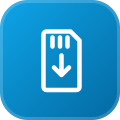
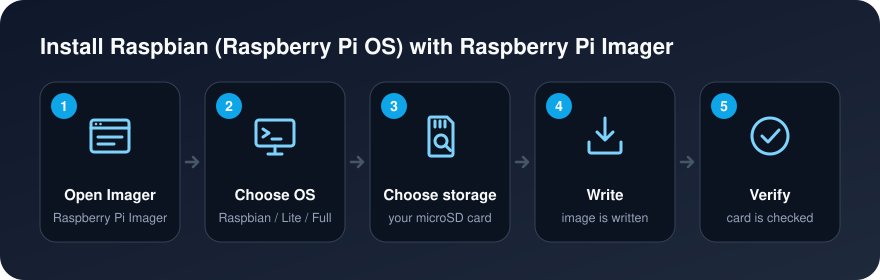

[Background](Background.md) / [Purpose](Purpose.md) / [Getting Started](Getting_Started.md) / [Cluster Guide](Cluster_Guide.md)

# Installing Raspbian

Raspbian can be installed the same way you write any other operating system image.

* [How-to Install Raspbian](#how-to-install-raspbian)
* [Software Updates](#software-updates)

## How-to Install Raspbian

1. Format your micro SD card ([how-to](Formatting_SD_Cards.md))
2. Download [Raspberry Pi Imager](Formatting-SD-Cards#raspberry-pi-imager-downloads)
3. Install Raspberry Pi Imager in your computer
4. Open Raspberry Pi Imager
5. Click on `Choose OS`

6. Select between `Raspbian`, `Raspbian Lite`, and `Raspbian Full` images

7. Click on `Choose SD Card`

8. Select your micro SD card

9. Click on `Write`

10. Imager will start writing the image to the micro SD card and verify its contents
11. Wait until it finish
12. Done

## Software Updates

Refer to the [Software Updates](Software_Updates.md) wiki page.
