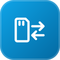
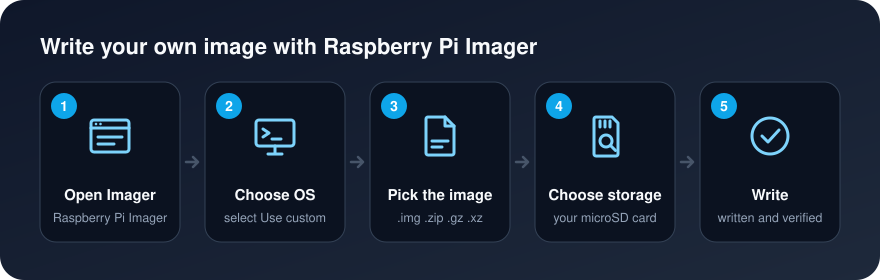

[Background](Background.md) / [Purpose](Purpose.md) / [Getting Started](Getting_Started.md) / [Cluster Guide](Cluster_Guide.md)

# Read & Write OS Images

Operating system images are similar but different from zipped files. Similar because contents are "compressed" but different because an image cannot be extracted like a zip file.

It is worth mentioning that sometimes images can come in zip format. The reason for that is to compress the image even further and have a lighter file.

* [Read Images](#read-images)
* [Write Custom Images](#write-custom-images)

## Read Images

[Win32 Disk Imager](https://sourceforge.net/projects/win32diskimager/) is strictly for Windows operating system.

1. Download [Win32 Disk Imager](https://sourceforge.net/projects/win32diskimager/)
1. Install Win32 Disk Imager
1. Open Win32 Disk Imager
1. Write the Image file destination path (blue folder to browse)
    * Make sure file name ends with ".img"
    * Image will be stored in the folder location specified with the file name given
        * Example: `C:\Users\gitluis\Desktop\your-image-file-name.img`
1. Select the Device (micro SD drive)
1. Click on Read
1. Done

## Write Custom Images

1. Format your micro SD card ([how-to](Formatting-SD-Cards))
2. Download [Raspberry Pi Imager](Formatting-SD-Cards#raspberry-pi-imager-downloads)
3. Install Raspberry Pi Imager in your computer
4. Open Raspberry Pi Imager
5. Click on `Choose OS`

6. Select `Use custom`

7. Navigate to your `image.img` file and open it (images supported: *.img, *.zip, *.gz, *.xz)

8. Click on `Choose SD Card`

9. Select your micro SD card

10. Click on `Write`

10. The image will start being written to the micro SD card and verify its contents
11. Wait until it finish
12. Done
