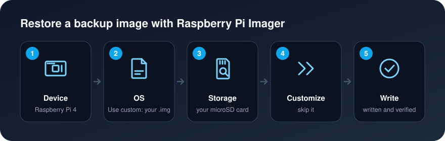

[Background](Background.md) / [Purpose](Purpose.md) / [Getting Started](Getting_Started.md) / [Cluster Guide](Cluster_Guide.md)


# Back Up and Restore Cards

**Goal:** save a microSD card to an image file on your computer, and write it back later.

**Run on:** your own computer, with the card in a card reader.

An OS *image* (`.img`) is a byte-for-byte copy of a whole card: every partition, file and setting. You can compress it (`.img.gz`, `.img.xz` or `.zip`) and Raspberry Pi Imager will still write it.

Back up `master` once the cluster works: it holds the HDFS NameNode's metadata, and without it the data on the workers can't be read.

* [Back up a card](#back-up-a-card)
* [Restore a card](#restore-a-card)
* [Cloning one card to the others](#cloning-one-card-to-the-others)


# Back up a card

Shut the Pi down first (`sudo shutdown -h now`), then move its card to your computer. The image is as large as the card, not the data on it, so a 32 GB card needs 32 GB free.


## Windows

1. Install [Win32 Disk Imager](https://sourceforge.net/projects/win32diskimager/).
2. In **Image File**, type a path ending in `.img`, for example `C:\Users\alice\Desktop\master-2026-10-30.img`.
3. In **Device**, pick the card's drive letter. Check it twice.
4. Click **Read** and wait.


## macOS

```bash
diskutil list                          # find the card, e.g. /dev/disk4
diskutil unmountDisk /dev/disk4
sudo dd if=/dev/rdisk4 of=master.img bs=4m status=progress
gzip master.img                        # optional: compress to master.img.gz
```

Replace `disk4` with your card's number. `rdisk` (with an r) is much faster than `disk`.


## Linux

```bash
lsblk                                  # find the card, e.g. /dev/sdb or /dev/mmcblk0
sudo umount /dev/sdb?*
sudo dd if=/dev/sdb of=master.img bs=4M status=progress conv=fsync
gzip master.img                        # optional
```

Replace `/dev/sdb` with your card. `dd` overwrites whatever `of=` points to without asking, so make sure `if=` is the card and `of=` is a file.


# Restore a card



1. Open Raspberry Pi Imager and choose your device.
2. For the operating system, scroll down to **Use custom** and pick your `.img`, `.img.gz`, `.img.xz` or `.zip` file.
3. Choose your microSD card.
4. **Skip customization**: the backup already has its hostname, user and keys.
5. Write and wait for the verification.

The new card must be at least as large as the one you backed up.


# Cloning one card to the others

Flashing each card separately with Imager ([Install OS](Install_OS.md)) is quicker and safer than cloning, since Imager sets each node's identity for you. Clone only if you have customized one node heavily and want to copy that work.

A clone is an exact copy, so every cloned node starts with the **same hostname, the same SSH host keys and the same machine ID** as the original. Nodes with duplicate identities confuse SSH ("host key changed" warnings) and some network services. Fix each clone on its first boot:

1. Before the first boot, with the card still in your computer, open `user-data` on the card's `bootfs` partition and change the `hostname:` line to the new name, such as `hostname: worker2`. Current Raspberry Pi OS resets the hostname from this file on every boot. Older images without this file can skip this step.

2. Boot the clone, log in with `ssh alice@<its-ip-address>` and give it new SSH host keys and a new machine ID:

    ```bash
    sudo hostnamectl set-hostname worker2
    sudo rm /etc/ssh/ssh_host_*
    sudo ssh-keygen -A
    sudo rm /etc/machine-id
    sudo systemd-machine-id-setup
    sudo reboot
    ```

3. On every computer that had logged in to the original, remove the old fingerprint for the new name:

    ```bash
    ssh-keygen -R worker2
    ```

**Check:** `hostname` prints the new name, and `cat /etc/machine-id` differs on every node.
