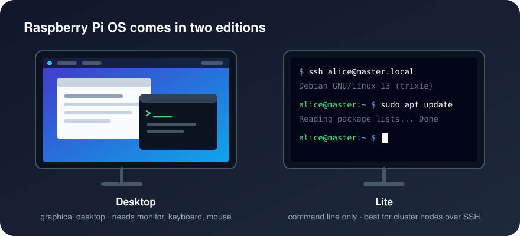

[Home](../README.md) · [Cluster Guide](Cluster_Guide.md) · [Troubleshooting](Troubleshooting.md)

# Software

A Raspberry Pi needs an operating system (OS) on its microSD card, just as a laptop needs Windows, macOS or Linux.

The official one is **Raspberry Pi OS**, a version of Debian Linux built for the Pi. It was called *Raspbian* until 2020, and older tutorials still use that name. The current release is based on Debian 13 ("Trixie").

## Which edition to use

Use **Raspberry Pi OS Lite (64-bit)** on every node.

- **Lite** has no desktop, which leaves more memory for Hadoop and Spark. You manage the nodes over SSH from your own computer.
- **64-bit** lets Java use the board's full memory, and Hadoop publishes ready-made 64-bit ARM builds.

The Desktop edition works too, but the desktop uses a few hundred megabytes of memory on every node for no benefit in a cluster.

Other operating systems, such as Ubuntu Server, also run on the Pi and can be picked in Raspberry Pi Imager. This guide assumes Raspberry Pi OS; commands may differ elsewhere.

## How you install it

Use **Raspberry Pi Imager**, the official tool for writing an OS to a card. It downloads the OS, writes it, and lets you set each node's hostname, user and SSH access before the first boot. [Install OS](Install_OS.md) walks through it.

NOOBS, the older installer that earlier versions of this guide recommended, is no longer maintained. Imager replaces it.

---

Back to the [Cluster Guide](Cluster_Guide.md)
